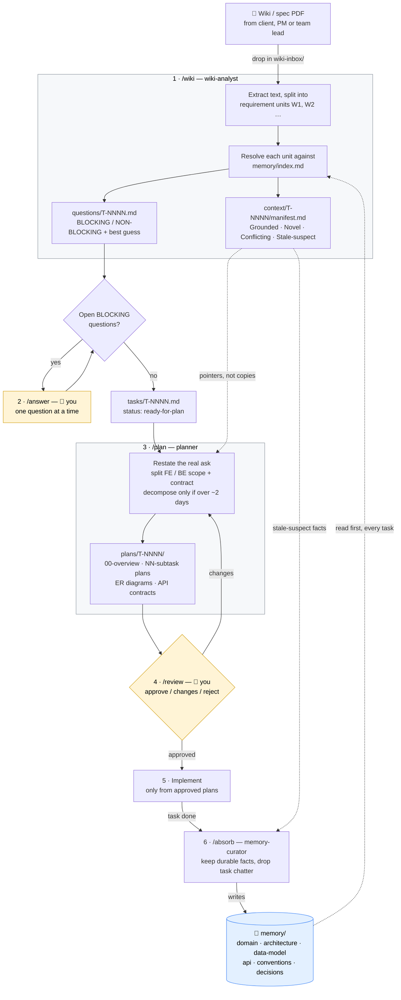

# Agentic Dev Workflow

Wiki PDF → analyzed task → reviewed plan → smarter memory box.

**Start here:** `BUILD_PLAN.md` (design + build order), then `CLAUDE.md` (operating rules).

## How the workflow runs



| Step | Command | Who | Output |
|------|---------|-----|--------|
| 1 | `/wiki` | wiki-analyst | Context manifest + questions; task file once unblocked |
| 2 | `/answer <ID>` | **you** | Answers recorded; task moves to `ready-for-plan` |
| 3 | `/plan <ID>` | planner | Plan files with FE/BE split, ER diagrams, API contracts |
| 4 | `/review <ID>` | **you** | Each sub-plan approved, changed or rejected |
| 5 | implement | developer / implementer | Code, written only from `approved` plans |
| 6 | `/absorb <ID>` | memory-curator | Durable knowledge folded back into `memory/` |

The yellow boxes are the human gates. The memory box closes the loop: every finished task makes the next one cheaper to analyse and plan.

## Quick start
```bash
chmod +x scripts/*.sh
# then in Claude Code:
/wiki some-spec.pdf
/answer T-0001
/plan T-0001
/review T-0001
/absorb T-0001
```

Do Phase 1 of `BUILD_PLAN.md` (seed `memory/`) before anything else. An empty memory box makes every other part of this useless.
