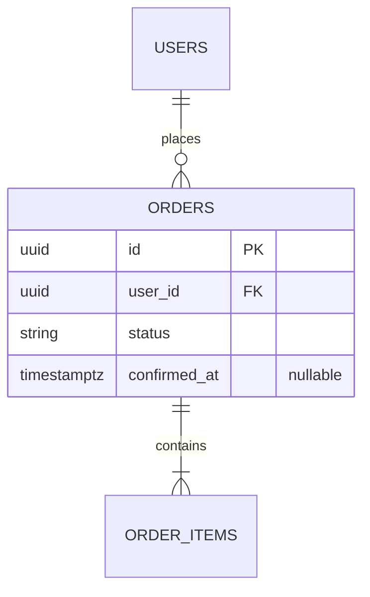

# ER — <what changes>

## Diagram

> Existing tables in plain style, NEW/CHANGED tables noted below. Never draw a new table without its neighbours.

## What is new or changed
| Table | New/Changed | Columns | Constraints | Indexes |
|-------|-------------|---------|-------------|---------|

## Relationships to existing schema
| From | To | Cardinality | FK / join column | Source of truth |
|------|----|-------------|------------------|-----------------|

## Migration
- Forward:
- Backfill of existing rows:
- Reversible?:
- Downtime / lock risk:

## Source
Existing schema read from `memory/data-model/<file>.md`.
